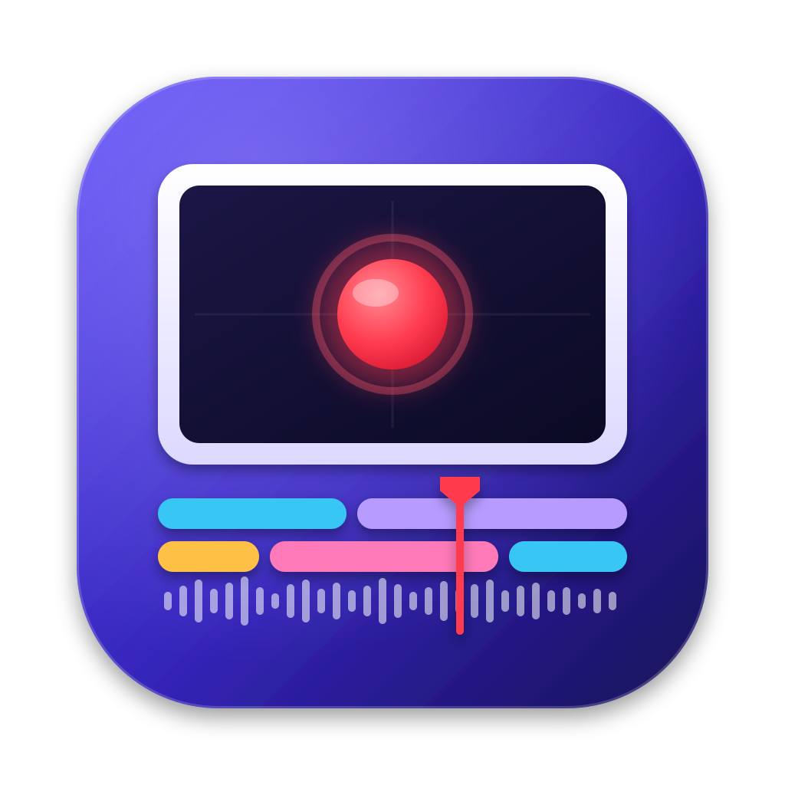

<p align="center"></p>

# Tapeline — free, open-source screen recorder & editor for macOS

Records your screen, then lets you edit on a multi-track timeline. It opens
and saves Camtasia® `.cmproj` / `.tscproj` projects, so a project started in
Camtasia on another Mac or PC can be edited here.

> This is an independent project. It is not affiliated with or endorsed by
> TechSmith. Camtasia is a trademark of TechSmith Corporation and is used here
> only to describe file compatibility. The code is a clean-room
> implementation: it ships no TechSmith code, binaries or assets.

## Status

| Part | State |
|---|---|
| `TSCProjKit`: project read/write | ✅ lossless round-trip for format 2.0–10.0, Mac + Windows projects |
| `tscproj` CLI | ✅ `info`, `roundtrip` |
| App icon | ✅ `Design/AppIcon` |
| Media decode (`.trec`, mp4, images) | ⏳ via AVFoundation + FFmpeg (`tscc2`) |
| Compositor / preview | ⏳ |
| Timeline UI | ⏳ |
| Screen + webcam + mic recorder | ⏳ ScreenCaptureKit |
| Export | ⏳ |

## Build

```sh
swift build
swift test
swift run tscproj info "~/Documents/demo project.cmproj"
swift run tscproj roundtrip path/to/project.tscproj -o /tmp/copy.tscproj
Design/AppIcon/build-icon.sh        # → Design/AppIcon/build/AppIcon.icns
```

## Layout

```
Sources/TSCProjKit/   format library (JSON tree, time, clips, params, bundle)
Sources/tscproj/      CLI
Tests/                Swift Testing suite; Fixtures/demo.tscproj
docs/FORMAT.md        format spec with observed/inferred/unknown tags
Design/AppIcon/       icon sources + build script
```

## Roadmap to Camtasia parity

1. **Render engine.** Decode media (AVFoundation, plus FFmpeg for `tscc2`),
   then use a Metal compositor that applies transform, crop and opacity per
   clip, and plays keyframes.
2. **Editor shell.** A SwiftUI/AppKit window with media bin, canvas, timeline
   and properties panel, plus undo/redo. Every edit goes through
   `TSCProjKit`, so saved files stay compatible.
3. **Recorder.** ScreenCaptureKit for the screen, AVCapture for webcam and
   mic, and a cursor/click event log.
4. **Effects.** Callouts, transitions, cursor effects, zoom-n-pan, masks,
   shadows, rounded corners, and audio (noise removal, normalisation).
5. **Export.** MP4/MOV/GIF through AVAssetWriter or FFmpeg.
6. **Captions.** Local Whisper transcription feeding dynamic captions.

## License

GPL-3.0-or-later. See [LICENSE](LICENSE). You may use, study, modify and share
this software. If you distribute a modified version, its source must stay open
under the same licence.

## Rules for contributors

- Only use observed behaviour and file formats (interoperability). Never copy
  TechSmith code.
- Don't commit TechSmith assets: themes, shaders, sample projects, icons or
  sounds. Tests read Camtasia's sample projects from a local install when one
  is present.
- Don't add anything that interacts with Camtasia's licensing.
